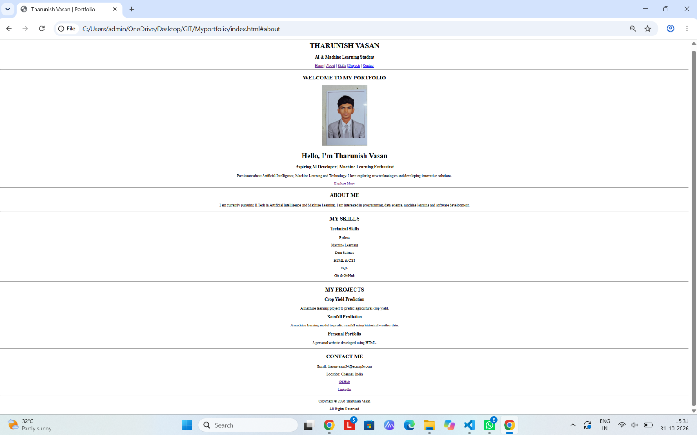

# Ex01 Portfolio
## Date:

## AIM
To create a Portfolio using HTML.

## ALGORITHM
### STEP 1
Create an HTML file (index.html)


### STEP 2
Include a navigation bar with links to different sections.

### STEP 3
Add structured sections for introduction, about, projects, and contact details.

### STEP 4
Define global styles for fonts, colors, and layout.

### STEP 5
Style the header, navigation bar, and sections.

### STEP 7
Use Flexbox or CSS Grid for layout design.

### STEP 8
Add hover effects and transitions for interactivity.

### STEP 9
Add Images and Media.

### STEP 10
Use optimized images for a professional look.

### STEP 11
Open the HTML file in a browser to check layout and functionality.

### STEP 12
Fix styling issues and refine content placement.

### STEP 13
Deploy the Portfolio.

### STEP 14
Upload to GitHub Pages for free hosting.

## PROGRAM
```

<!DOCTYPE html>
<html lang="en">
<head>
    <meta charset="UTF-8">
    <meta name="viewport" content="width=device-width, initial-scale=1.0">
    <title>Tharunish Vasan | Portfolio</title>
</head>

<body>

    <center>
        <header>
            <h1>THARUNISH VASAN</h1>
            <h3>AI & Machine Learning Student</h3>

            <nav>
                <a href="#home">Home</a> |
                <a href="#about">About</a> |
                <a href="#skills">Skills</a> |
                <a href="#projects">Projects</a> |
                <a href="#contact">Contact</a>
            </nav>
        </header>

        <hr>

        <section id="home">
            <h2>WELCOME TO MY PORTFOLIO</h2>

            

            <h1>Hello, I'm Tharunish Vasan</h1>

            <h3>Aspiring AI Developer | Machine Learning Enthusiast</h3>

            <p>
                Passionate about Artificial Intelligence,
                Machine Learning and Technology.
                I love exploring new technologies and
                developing innovative solutions.
            </p>

            <a href="#about">Explore More</a>
        </section>

        <hr>

        <section id="about">
            <h2>ABOUT ME</h2>

            <p>
                I am currently pursuing B.Tech in Artificial
                Intelligence and Machine Learning.

                I am interested in programming, data science,
                machine learning and software development.
            </p>
        </section>

        <hr>

        <section id="skills">
            <h2>MY SKILLS</h2>

            <h3>Technical Skills</h3>

            <p>Python</p>
            <p>Machine Learning</p>
            <p>Data Science</p>
            <p>HTML & CSS</p>
            <p>SQL</p>
            <p>Git & GitHub</p>
        </section>

        <hr>

        <section id="projects">
            <h2>MY PROJECTS</h2>

            <h3>Crop Yield Prediction</h3>
            <p>
                A machine learning project to predict
                agricultural crop yield.
            </p>

            <h3>Rainfall Prediction</h3>
            <p>
                A machine learning model to predict
                rainfall using historical weather data.
            </p>

            <h3>Personal Portfolio</h3>
            <p>
                A personal website developed using HTML.
            </p>
        </section>

        <hr>

        <section id="contact">
            <h2>CONTACT ME</h2>

            <p>Email: tharunvasan34@example.com</p>
            <p>Location: Chennai, India</p>

            <p>
                <a href="https://github.com/Tharunvasan12">
                    GitHub
                </a>
            </p>

            <p>
                <a href="https://linkedin.com/in/Tharun Vasan">
                    LinkedIn
                </a>
            </p>
        </section>

        <hr>

        <footer>
            <p>Copyright &copy; 2026 Tharunish Vasan</p>
            <p>All Rights Reserved.</p>
        </footer>
    </center>

</body>
</html>
```
## OUTPUT


## RESULT
The program for creating Portfolio using HTML and CSS is executed successfully.